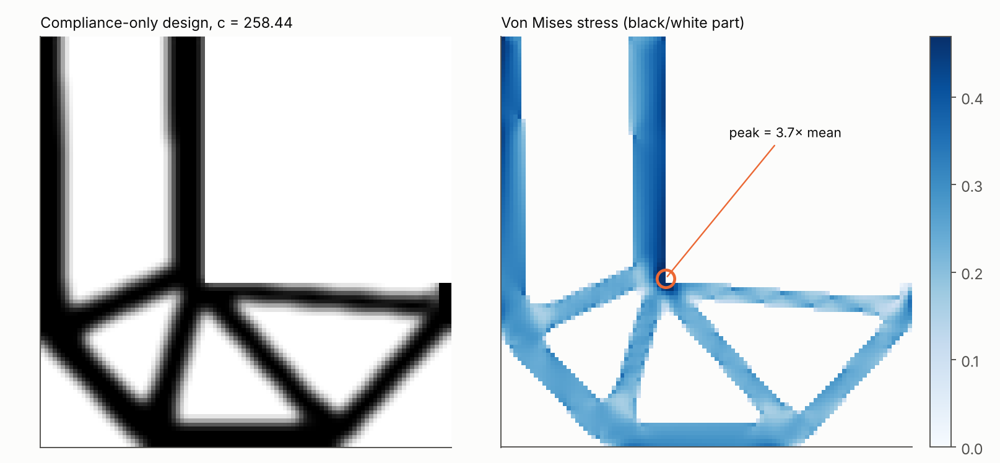
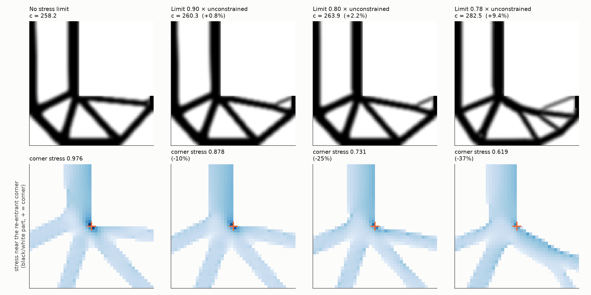

# FEM-Based Topology Optimization in Python

**Author:** Wei-Siang (Morris) Wang · B.S. Civil Engineering, National Chung Hsing University

Topology optimization answers a simple question: **if I can only use a certain amount of material,
where should I put it to make the stiffest possible part?** The computer starts from a gray block
and gradually removes material that isn't doing much work, until a structure appears.

I wrote the whole thing myself in Python, using only NumPy and SciPy: the finite element solver
that calculates how a part deforms, and the optimizer that decides where the material goes.
Before trusting any result, I checked the code against textbook solutions and a well-known
published benchmark. Then I used it to study a few engineering questions.


## What this project shows

- **The solver gives the right answers.** On two problems with known exact solutions, the error
  drops to about 0.2% as the mesh gets finer.
- **The optimizer matches the literature.** It reproduces the benchmark from Andreassen et al. (2011)
  to within 0.002%: 216.81 and 233.71.
- **Supports change the whole design.** For the same bridge, fixed supports lead to an arch, while
  supports that can slide sideways make the optimizer add a tie along the bottom. The second bridge
  is 2.2× more flexible.
- **"Stiffest" doesn't mean "safe."** When I checked the stresses in the optimized part, the highest
  stress was at a sharp inside corner, about 2.4× the average. That corner would need to be rounded
  before the part could be built.
- **Smart layout beats a plain plate.** Using the same amount of material, the optimized designs are
  1.23–1.41× stiffer than a plain solid plate.
- **A stress limit makes the design safer for a small price.** I then added a stress constraint to the
  optimizer. On the standard L-bracket test, it lowers the stress at the sharp inside corner by about
  19–25% while the part loses only about 2–3% of its stiffness, with the same trend on three meshes.

---

## 1. Checking the finite element solver

The solver (`src/fem.py`) splits a 2D part into small four-node elements and calculates displacements
and stresses (plane stress, linear elastic). To make sure it is correct, `src/verify_fem.py` runs it on
two classic problems that have exact answers, using finer and finer meshes.

**Plate with a hole.** When a plate with a small round hole is pulled, theory says the stress at the
edge of the hole is exactly 3 times the normal stress (the Kirsch solution). The solver gets closer
and closer to 3:

| Mesh | Unknowns (DOFs) | Stress ratio from solver | Error |
|---|---|---|---|
| 16 × 32 | 1,122 | 3.031 | +1.02% |
| 32 × 64 | 4,290 | 3.022 | +0.72% |
| 64 × 128 | 16,770 | 3.012 | +0.41% |
| 128 × 256 | 66,306 | 3.007 | **+0.22%** |

The coarsest mesh (8 × 16) happens to give +0.34%, but only because two errors cancel out, so it is
left out of the table.


**Cantilever beam.** For a beam fixed at one end with a load at the tip, I compared the tip deflection
with beam theory (Timoshenko). With a very coarse mesh the beam is far too stiff (−32.6% error). This is
a known weakness of simple four-node elements in bending, called shear locking. With a fine mesh
(320 × 32) the error is **−0.23%**.


## 2. The optimizer

The optimizer (`src/topopt.py`) uses the standard SIMP method. Here is the idea in plain terms:

1. Every element gets a density between 0 (empty) and 1 (solid). Everything starts out gray.
2. The solver calculates how much the structure bends (its *compliance*, where lower means stiffer).
3. For each element, the code calculates how much the compliance would improve if that element had a
   little more material.
4. Material moves to where it helps most, while the total amount stays fixed.
5. Steps 2–4 repeat until the design stops changing.

A filter keeps the design from turning into a fine checkerboard pattern. I implemented both common
versions: the sensitivity filter (Sigmund 2001) and the density filter (Bruns & Tortorelli 2001).

<details>
<summary>The math, for those who want it</summary>

Minimize c(x) = Fᵀ U(x), subject to K(x) U = F, Σ xₑ / N = V*, and 0 ≤ xₑ ≤ 1

- Material model: Eₑ = E_min + xₑᵖ (E₀ − E_min), with p = 3
- Sensitivity (adjoint method): ∂c/∂xₑ = −p xₑᵖ⁻¹ (E₀ − E_min) uₑᵀ K₀ uₑ
- Update: optimality criteria, with bisection on the volume multiplier and a move limit of 0.2
- The code also supports regions that are forced to be solid or empty, plus distributed loads
  (used for the bridge deck)
- The element stiffness comes from the same verified element in `fem.py`

</details>

### Checking against a published benchmark

The "MBB beam" is the standard test problem in this field. I ran it with the same settings as
Andreassen et al. (2011): half model 60 × 20, 50% material, p = 3, filter radius 2.4.

| Filter | This code | Published value |
|---|---|---|
| Sensitivity | **216.81** | 216.81 |
| Density | **233.71** | 233.71 |

The two sets of numbers agree to within 0.002%.


> **A note on the paper:** the example call printed in the paper uses a filter radius of 1.5, but the
> numbers in its Fig. 3 come from a radius of 2.4, as the text of the paper says. With 1.5, this code
> gives 203.19 and 218.80.

**Does the mesh size matter?** I ran the same problem on three meshes (60 × 20, 120 × 40, 240 × 80),
with the filter radius kept at 4% of the beam length. The layout stays the same, and the compliance
changes by only 1.9% (233.71 → 238.15).


**Cantilever** (160 × 80, 40% material):


## 3. Engineering studies

These are in `src/run_extensions.py`.

### A. Bridge: the supports decide what kind of structure you get

I set up a bridge with a solid deck carrying a uniform load and gave the optimizer 25% of the space
as material. The only thing I changed between the two runs was how the ends are supported.

| Supports | What the optimizer built | Compliance |
|---|---|---|
| Pinned (can push back sideways) | An arch that passes through the deck, with hangers | 22.19 |
| Roller (free to slide sideways) | The same arch plus a tie along the bottom (a tied arch) | 49.25 (2.2× more flexible) |

Nothing in the code knows what an arch or a tie is. The optimizer rediscovered a basic rule of bridge
engineering on its own: an arch pushes outward at its feet, so either the supports must hold it in,
or a tie must hold the two ends together. In both runs the arch rises to the top of the allowed space,
because a taller arch pushes outward less. In a real bridge, the required clearance would set this limit.

(The model uses only half the span, cut at the middle by symmetry. The figure shows the full bridge.)


### B. Is the optimized part actually safe?

The optimizer only cares about stiffness, not stress. To check stress, I took the 150 × 50 MBB
design, turned it into a clean solid/empty part (keeping 50% material), made the mesh 4× finer,
removed the empty elements, and analyzed it again. I compared it with a plain solid beam. The load
and the support were spread over a small pad, and the areas right around them were left out of the
peak search, since point loads create artificial stress spikes.

| | Plain solid beam | Optimized part (50% material) |
|---|---|---|
| Compliance (fine mesh) | 118.2 | 182.9 (keeps 65% of the solid beam's stiffness) |
| Highest von Mises stress (relative) | 0.343 | 0.481 (1.4× higher) |
| Where it occurs | bottom edge, at midspan | sharp inside corner, near the support |

In the optimized part, the highest stress is at a sharp inside corner of one of the holes, about 2.4×
the average stress in the material. The edges of the part are made of square elements, so they are
jagged, and the stress at a jagged corner keeps rising as the mesh gets finer. This check therefore
shows *where* the weak spot is, not its exact value. To make the part for real, that corner would need
a fillet, or the optimization would need a stress limit built in.


### C. How much does optimization help?

I optimized the MBB beam (120 × 40) with 30% to 70% material. I then compared each design with a
plain solid plate that uses the same amount of material, spread evenly (a thinner plate).

| Material used | 30% | 40% | 50% | 60% | 70% |
|---|---|---|---|---|---|
| How much stiffer than a plain plate | 1.41× | 1.38× | 1.33× | 1.29× | 1.23× |

The less material you have, the more it pays to put it in the right place. I only studied 30–70% material:
with less material, the members become very thin on this 120 × 40 mesh, so lower amounts would need a
finer mesh to resolve them.


## 4. Stress-constrained optimization

Section 3B showed that the stiffest design can have a dangerous stress hot spot. The next step was to
let the optimizer see the stress and keep it under a limit. This part is in `src/lbracket.py`,
`src/stress.py`, `src/verify_stress.py` and `src/run_stress.py`.

### The test problem: an L-bracket

The L-bracket is the standard test for stress-based topology optimization. The top of the vertical arm
is clamped, and a downward load is spread over the upper end of the horizontal arm (with a small solid
pad under it). The inside corner of the L is sharp. In linear elasticity the stress at a sharp
inside corner is infinite (a stress singularity, Williams 1952), so any material that touches the
corner is highly stressed. All runs use 40% of the L-shaped area, the density filter, and a filter
radius of 3% of the side length.

When the optimizer only looks at stiffness, it runs a member tight around the inside corner, because
that is the shortest load path. The peak stress then sits right at the corner:



Because the corner stress is singular, its value keeps growing as the mesh gets finer (2.9×, 3.7×
and 4.2× the mean stress on 60 × 60, 100 × 100 and 140 × 140 meshes), while the compliance and the
layout stay the same (258.2, 258.4 and 259.5). Corner stresses are therefore only compared on the same
mesh below.

### What I added

1. **Stresses the optimizer can see** (`stress.py`). Each element's von Mises stress is multiplied by
   xₑ^0.5 (stress relaxation; Bruggi 2008, Le et al. 2010). Without this, an element that is almost
   empty still reports the stress of solid material, and the optimizer cannot remove it (the
   "singularity phenomenon" of stress constraints; Duysinx & Bendsøe 1998).
2. **One number instead of thousands of constraints.** The element stresses are combined with a
   p-norm (p = 8), which is always at least as large as the true maximum and approaches it as p grows.
   A small zone around the load (radius 6% of the side length) is left out, because the stress there
   comes from how the load is applied, not from the design.
3. **Sensitivities by the adjoint method.** One extra linear solve gives the derivative of the p-norm
   stress with respect to every element density.
4. **A different update rule.** The optimality-criteria update in `topopt.py` can only handle the
   volume constraint, so the stress-constrained runs use the Method of Moving Asymptotes (MMA;
   Svanberg 1987) through the `mmapy` package. The problem is: minimize compliance, subject to the
   volume limit and the p-norm stress limit.

### How I checked it

`verify_stress.py` checks the new code before it is used:

- **Stress:** constant-stress patch tests with exact answers (uniaxial tension, pure shear, equal
  biaxial tension), a comparison with the verified stress routine in `fem.py`, the relaxation factor,
  and the p-norm behaviour as p grows. All match to round-off.
- **Sensitivities:** compared with central finite differences on random designs; the largest
  relative error is about 3 × 10⁻⁴. (This check found a real bug: elements forced to be empty gave
  0 × ∞ in the derivative.)
- **MMA:** without the stress limit, MMA reaches a compliance of 258.2, within 0.1% of the
  optimality-criteria result (258.4) on the same 100 × 100 mesh.

### Results

The stress limit is set as a fraction of the p-norm stress of the unconstrained design, so the same
settings can be compared on different meshes. The stress values below are for the black/white part
(same volume), analysed again on the same mesh.



| Stress limit | Mesh | Stiffness loss | Corner stress |
|---|---|---|---|
| 0.90 × unconstrained | 100 × 100 | +0.8% | −10% |
| | 140 × 140 | +1.7% | −9% |
| | 200 × 200 | +2.3% | −9% |
| 0.80 × unconstrained | 100 × 100 | +2.2% | −25% |
| | 140 × 140 | +2.5% | −20% |
| | 200 × 200 | +3.0% | −19% |

The stress limit moves the horizontal member down and away from the corner, so the joint becomes
smoother and the corner stress drops. The layouts and the trend are the same on all three meshes. On
finer meshes the stiffness cost grows slightly and the corner-stress reduction shrinks slightly, so
the conservative summary is: about 19–25% lower corner stress for about 2–3% of the stiffness.

**A result I did not keep.** With a slightly tighter limit (0.78 ×), the 100 × 100 run found a different
layout in which the horizontal member slopes well away from the corner (corner stress −37%, but 9.4%
stiffness loss). The 140 × 140 and 200 × 200 runs did not reproduce it; both found the same layout as
the 0.80 × case. The 100 × 100 result is a different local optimum, which is common in
stress-constrained problems, so it is not used as a conclusion. All runs are in
`results/stress_study_summary.json`, `results/stress_study_140_summary.json` and
`results/stress_study_200_summary.json`.

## 5. Limitations

- 2D only, linear elastic, one load case, and only one goal (stiffness).
- The density filter leaves blurry gray edges. I didn't add a sharpening step (such as Heaviside
  projection), so designs are converted to solid/empty by a threshold before they are evaluated.
- In the stress check, the part edges are jagged, so peak stresses at corners depend on the mesh.
- The larger runs stop when the compliance changes by less than 0.01% over 10 iterations. The
  benchmark runs use the original stopping rule from the paper (design change below 0.01).
- Stress-constrained runs: the stress-constrained problem has many local optima, so results depend on
  the settings and the mesh (see the 0.78 × case above). Some runs stopped at the iteration cap (700)
  while still satisfying both constraints. Thin gray members appear near the load pad; the black/white
  parts are still connected and carry the load, but spreading the load more widely would be cleaner.
  The comparison with the literature is qualitative only: published L-bracket studies use different
  formulations (for example minimum volume with local stress constraints), so the numbers are not
  directly comparable.

## 6. What could come next

- Heaviside projection, for crisp solid/empty designs
- Stress constraints with adaptive p-norm scaling (Le et al. 2010) and a minimum-volume formulation
- Multiple load cases, and 3D with an iterative solver
- Smoothing the boundary and exporting the shape to CAD or STL

## Run it yourself

```bash
pip install -r requirements.txt
cd src
python verify_fem.py        # checks the solver against exact solutions
python run_benchmarks.py    # published benchmark, mesh study, cantilever, GIF
python run_extensions.py    # bridge, stress check, material trade-off
python lbracket.py          # L-bracket, compliance only (about 30 s)
python verify_stress.py     # checks for the stress constraint (a few seconds)
python run_stress.py        # stress-constrained L-bracket study, 100 x 100 (about 10 min)
python run_stress.py 140    # the same study on a 140 x 140 mesh (longer)
python run_stress.py 200    # and on a 200 x 200 mesh (about 1 hour)
```

The first three scripts together take about 5 minutes. Their results were reproduced exactly on Windows
(Python 3.14) and Linux (Python 3.13). The stress-constrained study agrees between the two systems to
within 0.3%: the long MMA runs accumulate tiny round-off differences, which do not change any of the
percentages reported above. Every figure and a JSON summary of each run are saved in `results/`; the
first three scripts also have a text copy of their console output there.

To run a single case from Python (from inside `src/`):

```python
import topopt
r = topopt.top(60, 20, volfrac=0.5, penal=3.0, rmin=2.4, ft="density", problem="mbb")
print(r["c"])               # 233.71
```

## What's in the folder

```
src/
  fem.py              finite element solver (four-node elements, plane stress)
  topopt.py           optimizer: SIMP, filters, update rule, test problems
  verify_fem.py       checks against the plate-with-hole and cantilever solutions
  run_benchmarks.py   published benchmark, mesh study, cantilever, animation
  run_extensions.py   bridge, stress check, material trade-off
  lbracket.py         L-bracket problem and compliance-only reference
  stress.py           relaxed stresses, p-norm stress and its adjoint sensitivity
  verify_stress.py    checks for stress.py (exact answers and finite differences)
  run_stress.py       stress-constrained optimization with MMA, and the study
  style.py            shared figure style
results/              figures, GIF, and the saved output of every run
```

## References

- Andreassen, E., Clausen, A., Schevenels, M., Lazarov, B. S., & Sigmund, O. (2011). Efficient topology
  optimization in MATLAB using 88 lines of code. *Structural and Multidisciplinary Optimization*, 43, 1–16.
- Bendsøe, M. P., & Sigmund, O. (2003). *Topology Optimization: Theory, Methods, and Applications* (2nd ed.). Springer.
- Bruggi, M. (2008). On an alternative approach to stress constraints relaxation in topology
  optimization. *Structural and Multidisciplinary Optimization*, 36, 125–141.
- Bruns, T. E., & Tortorelli, D. A. (2001). Topology optimization of non-linear elastic structures and
  compliant mechanisms. *Computer Methods in Applied Mechanics and Engineering*, 190, 3443–3459.
- Duysinx, P., & Bendsøe, M. P. (1998). Topology optimization of continuum structures with local stress
  constraints. *International Journal for Numerical Methods in Engineering*, 43, 1453–1478.
- Le, C., Norato, J., Bruns, T., Ha, C., & Tortorelli, D. (2010). Stress-based topology optimization for
  continua. *Structural and Multidisciplinary Optimization*, 41, 605–620.
- Sigmund, O. (2001). A 99 line topology optimization code written in Matlab. *Structural and
  Multidisciplinary Optimization*, 21, 120–127.
- Svanberg, K. (1987). The method of moving asymptotes—a new method for structural optimization.
  *International Journal for Numerical Methods in Engineering*, 24, 359–373.
- Timoshenko, S. P., & Goodier, J. N. (1970). *Theory of Elasticity* (3rd ed.). McGraw-Hill.
- Williams, M. L. (1952). Stress singularities resulting from various boundary conditions in angular
  corners of plates in extension. *Journal of Applied Mechanics*, 19, 526–528.
