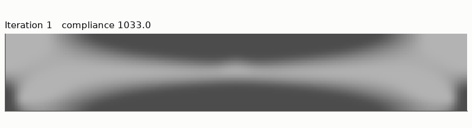
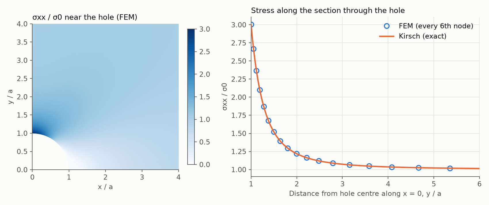
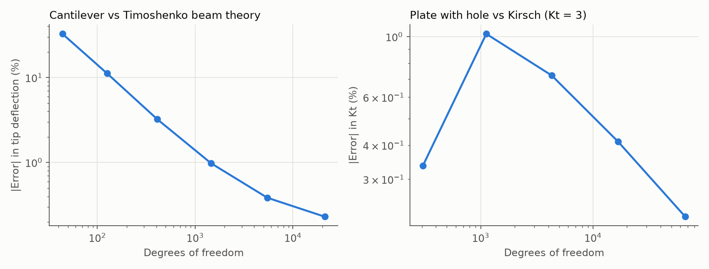
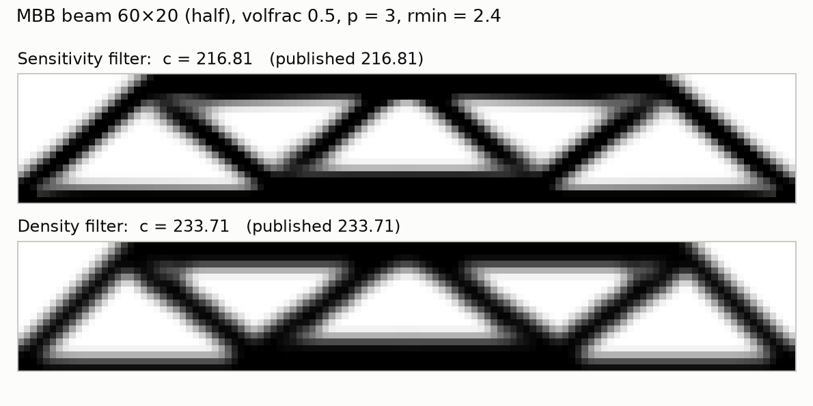
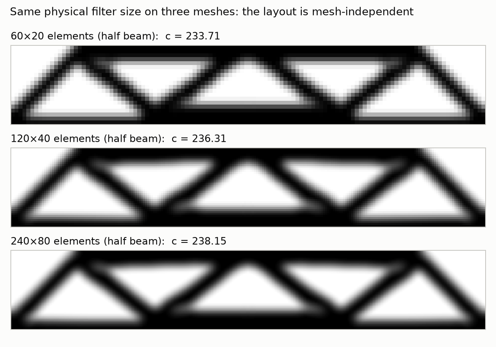
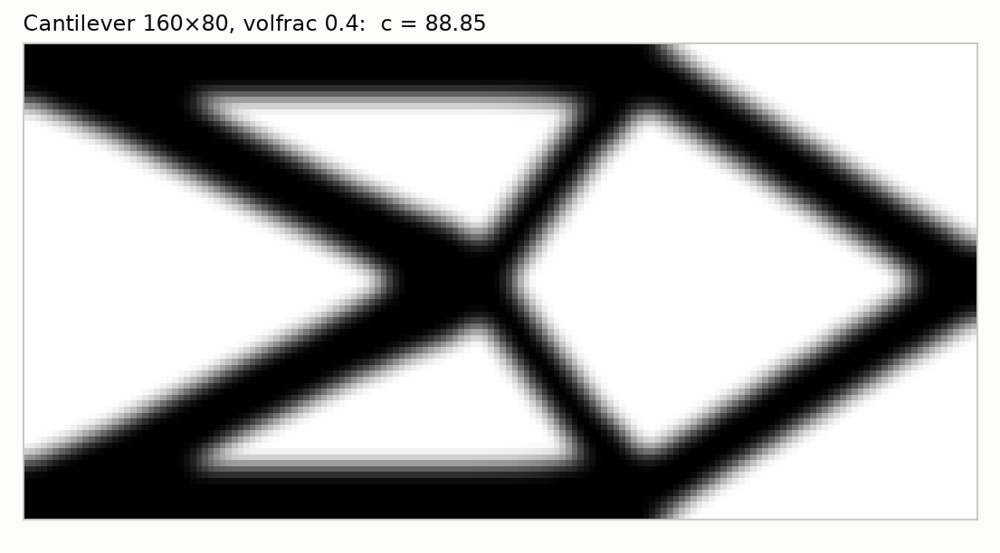
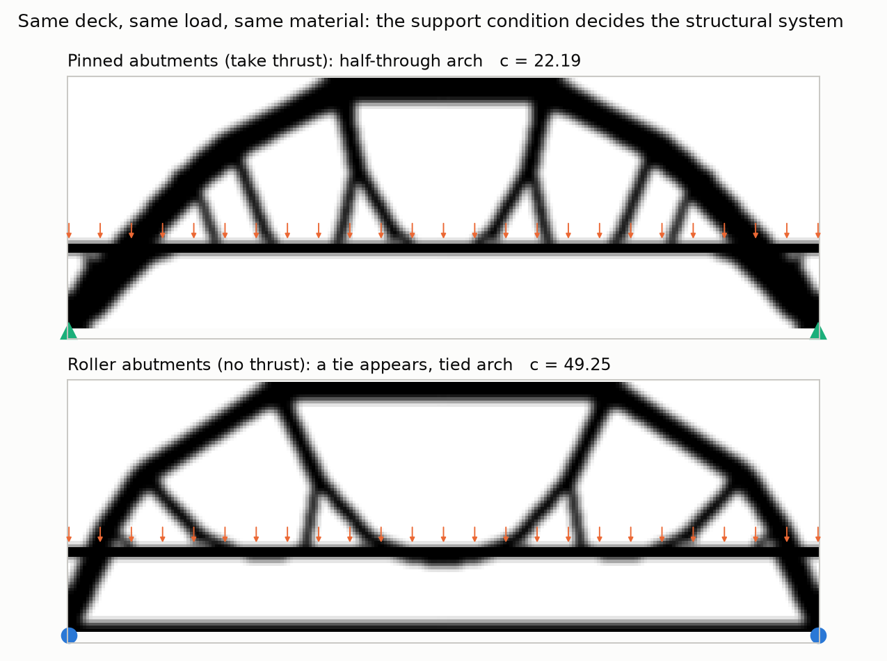
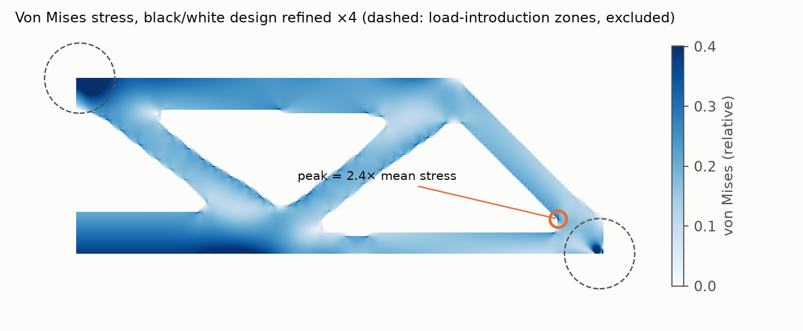
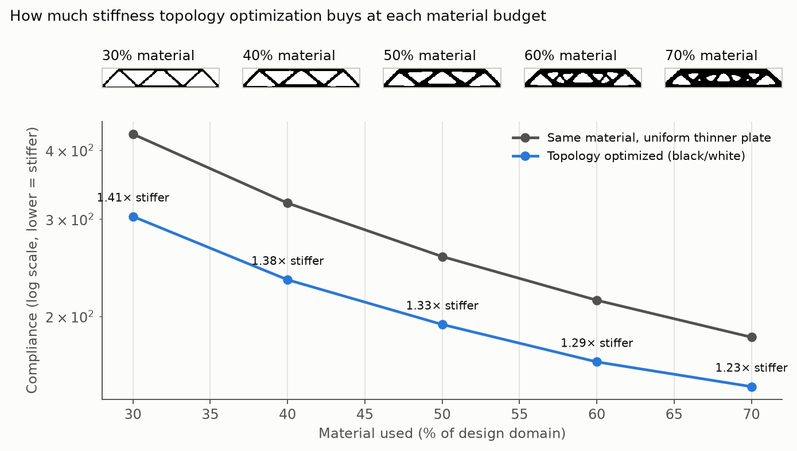

# FEM-Based Topology Optimization in Python

**Author:** Wei-Siang (Morris) Wang · B.S. Civil Engineering, National Chung Hsing University

Topology optimization answers a simple question: **if I can only use a certain amount of material,
where should I put it to make the stiffest possible part?** The computer starts from a gray block
and gradually removes material that isn't doing much work, until a structure appears.

I wrote the whole thing myself in Python, using only NumPy and SciPy: the finite element solver
that calculates how a part deforms, and the optimizer that decides where the material goes.
Before trusting any result, I checked the code against textbook solutions and a well-known
published benchmark. Then I used it to study a few engineering questions.



## What this project shows

- **The solver gives the right answers.** On two problems with known exact solutions, the error
  drops to about 0.2% as the mesh gets finer.
- **The optimizer matches the literature.** It reproduces the benchmark from Andreassen et al. (2011)
  to within 0.002%: 216.81 and 233.71.
- **Supports change the whole design.** For the same bridge, fixed supports lead to an arch, while
  supports that can slide sideways make the optimizer add a tie along the bottom. The second bridge
  is 2.2× more flexible.
- **"Stiffest" doesn't mean "safe."** When I checked the stresses in the optimized part, the highest
  stress was at a sharp inside corner, about 2.4× the average. That corner would need to be rounded
  before the part could be built.
- **Smart layout beats a plain plate.** Using the same amount of material, the optimized designs are
  1.23–1.41× stiffer than a plain solid plate.

---

## 1. Checking the finite element solver

The solver (`src/fem.py`) splits a 2D part into small four-node elements and calculates displacements
and stresses (plane stress, linear elastic). To make sure it is correct, `src/verify_fem.py` runs it on
two classic problems that have exact answers, using finer and finer meshes.

**Plate with a hole.** When a plate with a small round hole is pulled, theory says the stress at the
edge of the hole is exactly 3 times the normal stress (the Kirsch solution). The solver gets closer
and closer to 3:

| Mesh | Unknowns (DOFs) | Stress ratio from solver | Error |
|---|---|---|---|
| 16 × 32 | 1,122 | 3.031 | +1.02% |
| 32 × 64 | 4,290 | 3.022 | +0.72% |
| 64 × 128 | 16,770 | 3.012 | +0.41% |
| 128 × 256 | 66,306 | 3.007 | **+0.22%** |

The coarsest mesh (8 × 16) happens to give +0.34%, but only because two errors cancel out, so it is
left out of the table.



**Cantilever beam.** For a beam fixed at one end with a load at the tip, I compared the tip deflection
with beam theory (Timoshenko). With a very coarse mesh the beam is far too stiff (−32.6% error). This is
a known weakness of simple four-node elements in bending, called shear locking. With a fine mesh
(320 × 32) the error is **−0.23%**.



## 2. The optimizer

The optimizer (`src/topopt.py`) uses the standard SIMP method. Here is the idea in plain terms:

1. Every element gets a density between 0 (empty) and 1 (solid). Everything starts out gray.
2. The solver calculates how much the structure bends (its *compliance*, where lower means stiffer).
3. For each element, the code calculates how much the compliance would improve if that element had a
   little more material.
4. Material moves to where it helps most, while the total amount stays fixed.
5. Steps 2–4 repeat until the design stops changing.

A filter keeps the design from turning into a fine checkerboard pattern. I implemented both common
versions: the sensitivity filter (Sigmund 2001) and the density filter (Bruns & Tortorelli 2001).

<details>
<summary>The math, for those who want it</summary>

Minimize c(x) = Fᵀ U(x), subject to K(x) U = F, Σ xₑ / N = V*, and 0 ≤ xₑ ≤ 1

- Material model: Eₑ = E_min + xₑᵖ (E₀ − E_min), with p = 3
- Sensitivity (adjoint method): ∂c/∂xₑ = −p xₑᵖ⁻¹ (E₀ − E_min) uₑᵀ K₀ uₑ
- Update: optimality criteria, with bisection on the volume multiplier and a move limit of 0.2
- The code also supports regions that are forced to be solid or empty, plus distributed loads
  (used for the bridge deck)
- The element stiffness comes from the same verified element in `fem.py`

</details>

### Checking against a published benchmark

The "MBB beam" is the standard test problem in this field. I ran it with the same settings as
Andreassen et al. (2011): half model 60 × 20, 50% material, p = 3, filter radius 2.4.

| Filter | This code | Published value |
|---|---|---|
| Sensitivity | **216.81** | 216.81 |
| Density | **233.71** | 233.71 |

The two sets of numbers agree to within 0.002%.



> **A note on the paper:** the example call printed in the paper uses a filter radius of 1.5, but the
> numbers in its Fig. 3 come from a radius of 2.4, as the text of the paper says. With 1.5, this code
> gives 203.19 and 218.80.

**Does the mesh size matter?** I ran the same problem on three meshes (60 × 20, 120 × 40, 240 × 80),
with the filter radius kept at 4% of the beam length. The layout stays the same, and the compliance
changes by only 1.9% (233.71 → 238.15).



**Cantilever** (160 × 80, 40% material):



## 3. Engineering studies

These are in `src/run_extensions.py`.

### A. Bridge: the supports decide what kind of structure you get

I set up a bridge with a solid deck carrying a uniform load and gave the optimizer 25% of the space
as material. The only thing I changed between the two runs was how the ends are supported.

| Supports | What the optimizer built | Compliance |
|---|---|---|
| Pinned (can push back sideways) | An arch that passes through the deck, with hangers | 22.19 |
| Roller (free to slide sideways) | The same arch plus a tie along the bottom (a tied arch) | 49.25 (2.2× more flexible) |

Nothing in the code knows what an arch or a tie is. The optimizer rediscovered a basic rule of bridge
engineering on its own: an arch pushes outward at its feet, so either the supports must hold it in,
or a tie must hold the two ends together. In both runs the arch rises to the top of the allowed space,
because a taller arch pushes outward less. In a real bridge, the required clearance would set this limit.

(The model uses only half the span, cut at the middle by symmetry. The figure shows the full bridge.)



### B. Is the optimized part actually safe?

The optimizer only cares about stiffness, not stress. To check stress, I took the 150 × 50 MBB
design, turned it into a clean solid/empty part (keeping 50% material), made the mesh 4× finer,
removed the empty elements, and analyzed it again. I compared it with a plain solid beam. The load
and the support were spread over a small pad, and the areas right around them were left out of the
peak search, since point loads create artificial stress spikes.

| | Plain solid beam | Optimized part (50% material) |
|---|---|---|
| Compliance (fine mesh) | 118.2 | 182.9 (keeps 65% of the solid beam's stiffness) |
| Highest von Mises stress (relative) | 0.343 | 0.481 (1.4× higher) |
| Where it occurs | bottom edge, at midspan | sharp inside corner, near the support |

In the optimized part, the highest stress is at a sharp inside corner of one of the holes, about 2.4×
the average stress in the material. The edges of the part are made of square elements, so they are
jagged, and the stress at a jagged corner keeps rising as the mesh gets finer. This check therefore
shows *where* the weak spot is, not its exact value. To make the part for real, that corner would need
a fillet, or the optimization would need a stress limit built in.



### C. How much does optimization help?

I optimized the MBB beam (120 × 40) with 30% to 70% material. I then compared each design with a
plain solid plate that uses the same amount of material, spread evenly (a thinner plate).

| Material used | 30% | 40% | 50% | 60% | 70% |
|---|---|---|---|---|---|
| How much stiffer than a plain plate | 1.41× | 1.38× | 1.33× | 1.29× | 1.23× |

The less material you have, the more it pays to put it in the right place. Below about 30%, the members
become only 1–2 elements thick on this mesh, and the design falls apart into pieces. Lower amounts of
material would need a finer mesh.



## 4. Limitations

- 2D only, linear elastic, one load case, and only one goal (stiffness).
- The density filter leaves blurry gray edges. I didn't add a sharpening step (such as Heaviside
  projection), so designs are converted to solid/empty by a threshold before they are evaluated.
- In the stress check, the part edges are jagged, so peak stresses at corners depend on the mesh.
- The larger runs stop when the compliance changes by less than 0.01% over 10 iterations. The
  benchmark runs use the original stopping rule from the paper (design change below 0.01).

## 5. What could come next

- Heaviside projection, for crisp solid/empty designs
- Optimization with a stress limit (p-norm aggregation)
- Multiple load cases, and 3D with an iterative solver
- Smoothing the boundary and exporting the shape to CAD or STL

## Run it yourself

```bash
pip install -r requirements.txt
cd src
python verify_fem.py        # checks the solver against exact solutions
python run_benchmarks.py    # published benchmark, mesh study, cantilever, GIF
python run_extensions.py    # bridge, stress check, material trade-off
```

All three scripts together take about 5 minutes. The results were reproduced exactly on both Windows
and Linux (tested with Python 3.13). Every figure, plus a text and JSON copy of each run's output,
is saved in `results/`.

To run a single case from Python (from inside `src/`):

```python
import topopt
r = topopt.top(60, 20, volfrac=0.5, penal=3.0, rmin=2.4, ft="density", problem="mbb")
print(r["c"])               # 233.71
```

## What's in the folder

```
src/
  fem.py              finite element solver (four-node elements, plane stress)
  topopt.py           optimizer: SIMP, filters, update rule, test problems
  verify_fem.py       checks against the plate-with-hole and cantilever solutions
  run_benchmarks.py   published benchmark, mesh study, cantilever, animation
  run_extensions.py   bridge, stress check, material trade-off
  style.py            shared figure style
results/              figures, GIF, and the saved output of every run
```

## References

- Andreassen, E., Clausen, A., Schevenels, M., Lazarov, B. S., & Sigmund, O. (2011). Efficient topology
  optimization in MATLAB using 88 lines of code. *Structural and Multidisciplinary Optimization*, 43, 1–16.
- Bendsøe, M. P., & Sigmund, O. (2003). *Topology Optimization: Theory, Methods and Applications*. Springer.
- Bruns, T. E., & Tortorelli, D. A. (2001). Topology optimization of non-linear elastic structures and
  compliant mechanisms. *Computer Methods in Applied Mechanics and Engineering*, 190, 3443–3459.
- Sigmund, O. (2001). A 99 line topology optimization code written in Matlab. *Structural and
  Multidisciplinary Optimization*, 21, 120–127.
- Timoshenko, S. P., & Goodier, J. N. (1970). *Theory of Elasticity* (3rd ed.). McGraw-Hill.
